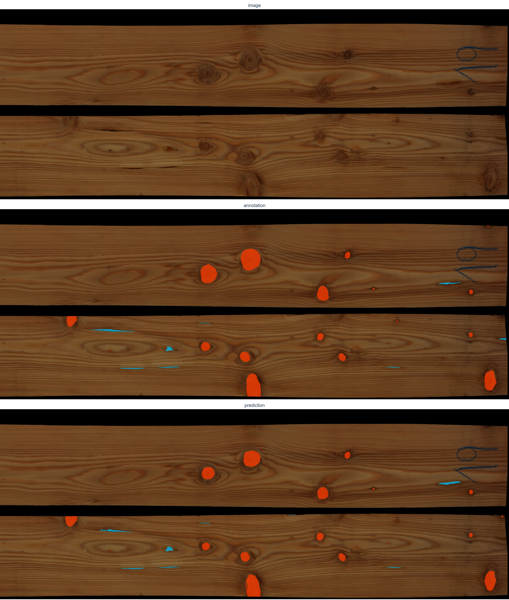
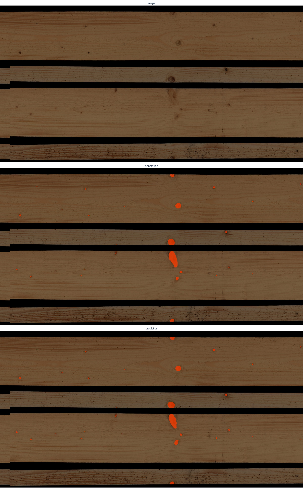
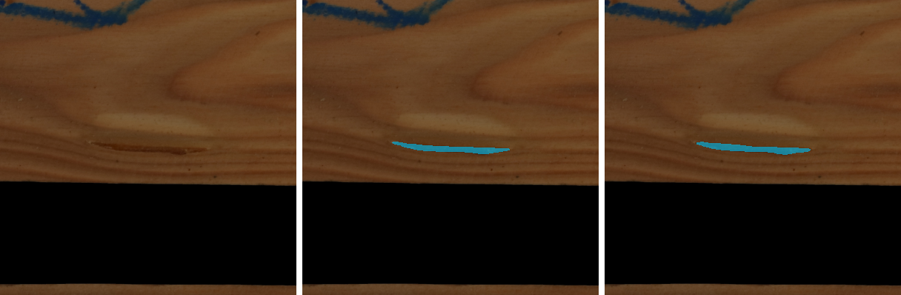
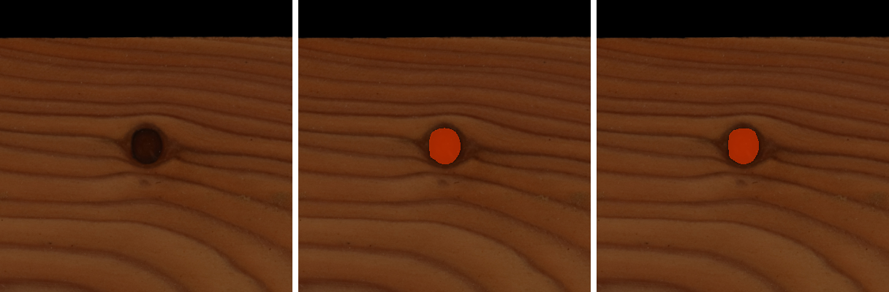
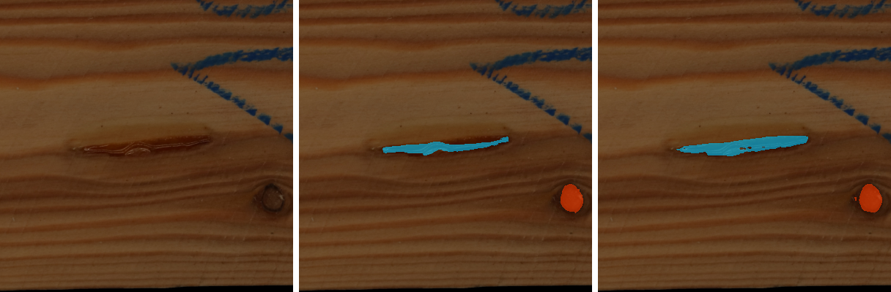
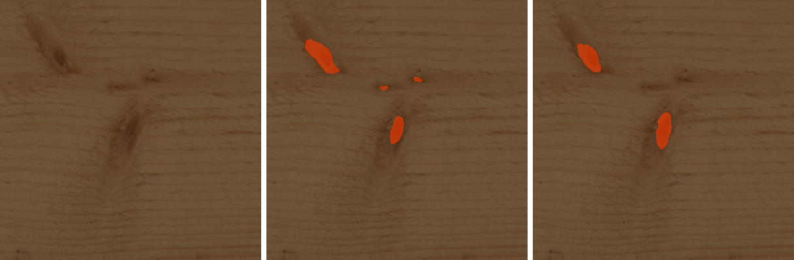
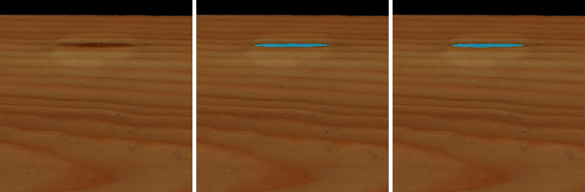
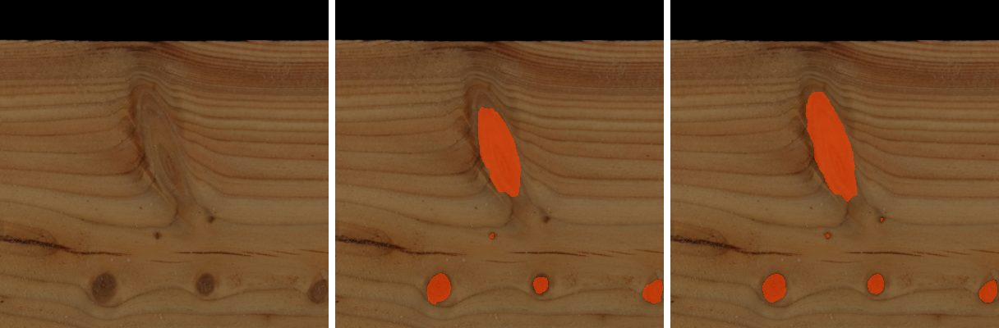
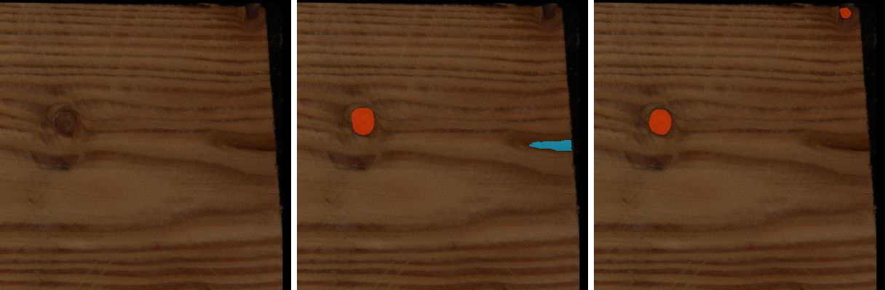
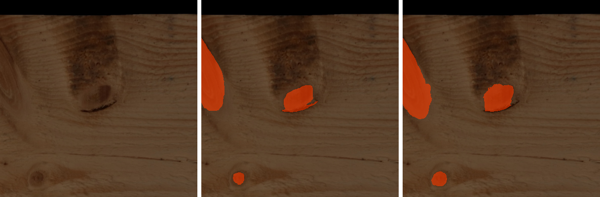

# Timber defect segmentation v1: model report

> **Warning: test boards were also used to choose between runs.** The model is chosen on the validation
> boards, and the test boards were checked as well before the choice (they agreed with validation). The
> reported test scores are therefore slightly optimistic. Run 4 is trained on the validation boards too, so
> it has no validation score; it is compared on test only.

**v1 = run 3, epoch 27** (MLflow `9d7849ff31fe4752aa4702b309912b36`, sha256 `fabbf4df…9917`). Run 4 (the same
recipe trained on 11 more boards) is reported as an experiment and not delivered.

Links: [MLflow on DagsHub](https://dagshub.com/AddictionLord/ct-log.mlflow/#/experiments/4), experiment
`ct-timber-v1` · Supervisely pre-label preview `camera_slider_prelabel_preview_v1` (385810) · data and
figure sources in [data/](data/) and [figures/](figures/).

Numbers use a decimal point. Metric names are the keys as logged by the evaluation (`inst_iou_knot`,
`map50_resin_pocket`, ...); `_defects` is the mean over the two classes knot and resin_pocket.

---

## Pro Matěje

**Co model umí teď.** Model v1 najde na fotografii plochy prkna dvě třídy vad: **suk** (`knot`, zdravé,
mrtvé a křídlové suky jsou sloučené do jedné třídy) a **smolník** (`resin_pocket`). Kromě toho odliší dřevo
od pozadí. Dřeň, zarostlou kůru (Bark_inclusion), kov (steel) a oblinu zatím nehledá: při trénování byly
tyto oblasti vynechané (model se na nich nic neučil a nebyl za ně ani trestán). Zdravý a mrtvý suk zatím
nerozliší.

Na 11 testovacích prknech, která model při učení neviděl (13 pásů, 745 suků a 28 smolníků v anotacích),
vychází model v1 (run 3) takto:

| třída | `inst_iou` | `map50` | anotovaných | předpovězených |
|---|---:|---:|---:|---:|
| knot | 0.748 | 0.807 | 745 | 793 |
| resin_pocket | 0.668 | 0.799 | 28 | 43 |

Zkusili jsme i model naučený na trénovacích i validačních prknech dohromady (run 4, o 11 prken víc). Suky
na testu našel o málo lépe (`inst_iou` 0.752, `map50` 0.815), ale smolníků předpověděl 68 místo 43 při 28
skutečných, na smrku 27 při 5 skutečných. Protože nemá validační prkna, na kterých by se dal nezávisle
porovnat, zůstává jako v1 run 3.

**Jak čísla číst.**
- Objekt je souvislá oblast jedné třídy na celém pásu prkna. Předpovězené objekty menší než 16 px
  (1 mm² při 4 px/mm) se zahazují.
- `inst_iou` (průměrné IoU na objekt): ke každému anotovanému objektu se najde nejlépe odpovídající
  předpovězený objekt (každý nejvýš jednou) a spočítá se jejich překryv, IoU = průnik / sjednocení.
  Objekt, který model nenašel nebo který se překrývá méně než 0.3, se počítá jako 0. Průměr přes všechny
  anotované objekty. 0.75 tedy znamená, že typický suk je nalezen a jeho obrys sedí zhruba ze tří čtvrtin;
  přesnost obrysu se u malých suků projeví víc než u velkých.
- `map50` (mAP při IoU 0.5): předpovězené objekty se seřadí podle jistoty modelu a za správný se bere ten,
  který překrývá anotovaný objekt aspoň z poloviny (IoU ≥ 0.5). Hodnota shrnuje přesnost (kolik
  předpovědí je správně) a úplnost (kolik vad model našel) přes všechny prahy jistoty; 1.0 by znamenalo,
  že všechny vady jsou nalezené bez jediného planého poplachu.
- U smolníků stojí čísla na malém počtu objektů (28 na testu, z toho 5 na smrku), takže jsou nejistá. Model
  navíc předpovídá víc smolníků, než je v anotacích (test 43 vs 28, validace 119 vs 87).
- U suků model chybuje hlavně na těch nejmenších: z nenalezených i z planých suků na testu je asi 80 %
  menších než 20 mm² (zhruba 5 mm v průměru).

**Náhled předanotací v Supervisely.** Projekt `camera_slider_prelabel_preview_v1` (385810) obsahuje 6 kusů
z trénovacích prken, které zatím nebyly anotované (larch_003_x28246, larch_030_x42502, larch_033_x14152,
spruce_003_x00000, spruce_033_x07840, spruce_043_x00000). Model je při učení neviděl, viděl ale jiné kusy
stejných prken. Třídy: `knot_unclassified` (suky z modelu, prosím překlasifikuj na sound / dead / wing),
`resin_pocket` a `wood` (dřevo podle stejného pravidla jako v trénovací sadě). Předanotace jsou z modelu
v1 (run 3, epocha 27), nahrané 3. 11. 2026 v 10:48–10:50 (nahradily dřívější verzi z modelu run 2). Na
těchto kusech mohou vypadat o něco lépe než na úplně nových prknech, protože model viděl jiné kusy stejných
prken. Kus, který opravíš, označ jako obvykle tagem `bumaska`.

| kus | wood | knot_unclassified | resin_pocket |
|---|---:|---:|---:|
| larch_003_x28246 | 2 | 63 | 5 |
| larch_030_x42502 | 2 | 43 | 4 |
| larch_033_x14152 | 2 | 23 | 4 |
| spruce_003_x00000 | 4 | 14 | 0 |
| spruce_033_x07840 | 4 | 27 | 0 |
| spruce_043_x00000 | 4 | 34 | 3 |

**Co od tebe potřebujeme.**
1. **larch_012_x28196** má tag `bumaska`, ale žádné anotace, přitom jsou na něm vidět suky. Prosím doanotuj
   ho. Pokud stihneš, ještě larch_033_x00000, spruce_025_x24148 a spruce_036_x15418: mají jen část anotací a
   nemají `bumaska`. Do trénování se dostanou při dalším sestavení sady.
2. **Modřín jen ze dvou stran.** Modřínová prkna jsou nasnímaná jen ze 2 ploch (smrk ze 4). Pokud jdou
   dosnímat zbylé dvě plochy, dostaneme víc dat právě tam, kde je nejvíc smolníků (203 z 232).
3. **Prkna k přesnímání.** 15 prken se do anotační sady nedostalo. U spruce_006, 007, 009, 011, 012, 014,
   015, 017, 018, 019 a 021 (sken 28. 10.) je pás se značkami na každém snímku useknutý, takže se nedají
   sešít. U spruce_061, larch_038 a larch_016 chybí na jedné ploše kus záběru a spruce_049 má jeden špatný
   šev. Jde je přesnímat?
4. **Anotace smolníků.** Smolníky jsou nejslabší místo modelu, protože jich je málo (216 použitelných, na
   smrku jen 29). Každý další pomůže víc než další suky. Prosím označ každý smolník, i malý, obrysem co
   nejtěsněji podle viditelné pryskyřice. Při kontrole náhledu se podívej i na smolníky, které model
   předpověděl navíc: pokud jsou skutečné, chybí v anotacích.
5. **Vynechané třídy.** Dřeň, Bark_inclusion, steel a oblinu dál anotuj stejně jako dosud. Ve v1 jsou
   vynechané, protože jich je na samostatné vyhodnocení málo (použitelných 48, 60, 16 a 4 objekty).
   Sound / dead / wing u suků taky rozlišuj dál, i když je v1 slučuje; v další verzi je zkusíme oddělit.

---

## Data

Scans by Matěj Šimek with the camera slider: spruce on 2026-10-28 (4 faces per board, about 7.7 px/mm),
larch on 2026-10-30 (2 faces per board, about 13.7 px/mm). Each face is stitched from the raw frames and the
faces of a board are stacked into one unrolled image ([camera_slider/README.md](../../camera_slider/README.md)),
which is cut into 4 pieces per board for annotation in Supervisely.

**Face order fix (KAR).** In our stitcher's output the two narrow spruce faces are swapped. Matěj fixed this
by hand in a copy of the annotation project, `camera_slider_KAR` (385745): all 148 spruce pieces with their
annotations moved, larch unchanged. A check with knots that cross a face edge
(`kar_check/edge_check.py`, 112 annotated spruce pieces) matches KAR's edge knots in the row order
0→1→2→3→0 and the original only as 0→3→2→1→0. v1 is trained on KAR; the stitcher fix is open.

**Annotations** (snapshot of KAR, 2026-11-02 11:32): 280 pieces of 70 boards (37 spruce, 33 larch),
5008 objects. A piece is used when it is tagged `bumaska` (reviewed), not tagged `wrong_stitch` and has at
least one object: 209 pieces.

Tab. 1: Objects per class in the snapshot. "Usable" = on pieces tagged `bumaska` and not `wrong_stitch`.

| class (Supervisely) | all | spruce | larch | usable | v1 class |
|---|---:|---:|---:|---:|---|
| dead_knot | 2,328 | 1,207 | 1,121 | 2,238 | knot |
| sound_knot | 2,265 | 817 | 1,448 | 2,112 | knot |
| wing_knot | 48 | 17 | 31 | 45 | knot |
| resin_pocket | 232 | 29 | 203 | 216 | resin_pocket |
| Bark_inclusion | 66 | 14 | 52 | 60 | ignored |
| pith | 49 | 23 | 26 | 48 | ignored |
| steel | 16 | 16 | 0 | 16 | ignored |
| oblina | 4 | 4 | 0 | 4 | ignored |

**Classes.** 0 background, 1 wood, 2 resin_pocket, 3 knot (sound, dead and wing knots merged); the ignored
classes and the tile padding are value 255, excluded from the loss and from the metrics. Overlaps are
resolved by priority background < wood < ignore < resin_pocket < knot. Wood is the N largest components of
each piece (4 for spruce, 2 for larch), holes filled.

**Strips, tiles and split.** Consecutive usable pieces of a board are joined into strips (93 strips), both
species are resampled to 4 px/mm and cut into 800 × 800 px tiles (200 × 200 mm) with a 200 px overlap. The
overlap equals the 99th percentile of the knot extent (49.6 mm), so every sound and dead knot is whole in at
least one tile. The split is by board, stratified by species, and fixed in
[camera_slider/splits/timber_v1.json](../../camera_slider/splits/timber_v1.json).

Tab. 2: Split of timber_v1.

| split | spruce boards | larch boards | tiles | knot objects (spruce / larch) | resin_pocket objects (spruce / larch) | ignored objects |
|---|---:|---:|---:|---:|---:|---:|
| train | 25 | 23 | 3,503 | 2,893 (1,334 / 1,559) | 103 (20 / 83) | 74 |
| val | 6 | 5 | 766 | 764 (274 / 490) | 86 (4 / 82) | 37 |
| test | 6 | 5 | 868 | 738 (405 / 333) | 27 (5 / 22) | 17 |

Test boards: larch_004, 008, 013, 019, 025; spruce_001, 002, 022, 026, 032, 046.

These are annotated objects ([data/object_counts.json](data/object_counts.json), from timber_v1
`objects.csv`). The evaluation counts connected components on whole strips instead (`n_gt_<class>` next
to the metrics: test 745 knots and 28 resin pockets, val 777 and 87): touching objects merge and an object
cut by an ignored region splits.

Sources: CT-12 snapshot statistics (`ct12_stats/report.md`, `stats.json`), timber_v1 `DATASET.json`,
`strips.csv`, `tiles.csv`, `objects.csv`.

## Model and training

U-Net (segmentation_models_pytorch) with an EfficientNetV2-S encoder (`tu-tf_efficientnetv2_s`, ImageNet
weights) and decoder 512-256-128-64-32, RGB input, 4 output classes. Loss: focal (gamma 2, weight 0.6) plus
soft Dice (weight 0.4); lr 1e-4 with a cosine schedule, batch 6, bf16, EMA weights
(decay 0.9995), seed 0. This is the recipe of the CT model M5, trained from ImageNet weights, not from M5.
The checkpoint of each run is the epoch with the best `val/inst_iou_defects` averaged over a 5-epoch window
(per tile, logged in MLflow).

Tab. 3: Runs. Each run changes the listed thing against the run before it. Strip-level scores (see
Evaluation); epoch = MLflow step, 0-based, as in the checkpoint file name. Best value per column in bold,
higher is better.

| run | MLflow run ID | change tested | epochs | chosen epoch | smoothed `val/inst_iou_defects` (per tile) | val `inst_iou_defects` | val `map50_defects` | test `inst_iou_defects` | test `map50_defects` |
|---|---|---|---:|---:|---:|---:|---:|---:|---:|
| 1 | [`17e1310c4e404ff6a3cdea2a43c96f07`](https://dagshub.com/AddictionLord/ct-log.mlflow/#/experiments/4/runs/17e1310c4e404ff6a3cdea2a43c96f07) | M5 recipe; flips and colour jitter | 64 planned, stopped after 18 | 5 | 0.347 | 0.474 | 0.518 | 0.436 | 0.415 |
| 2 | [`e84875b3078a424ba609f269cf0569da`](https://dagshub.com/AddictionLord/ct-log.mlflow/#/experiments/4/runs/e84875b3078a424ba609f269cf0569da) | Dice term only on tiles where the class is present (`dice_present_only`) | 64 | 24 | 0.696 | 0.690 | 0.779 | 0.695 | 0.777 |
| **3 (v1)** | [`9d7849ff31fe4752aa4702b309912b36`](https://dagshub.com/AddictionLord/ct-log.mlflow/#/experiments/4/runs/9d7849ff31fe4752aa4702b309912b36) | strong augmentation (`augment_strength` strong) and 32 epochs | 32 | 27 | **0.700** | **0.700** | **0.791** | 0.708 | **0.803** |
| 4 | [`ce10a131a63344668f467765fe9ae8da`](https://dagshub.com/AddictionLord/ct-log.mlflow/#/experiments/4/runs/ce10a131a63344668f467765fe9ae8da) | run 3 recipe trained on train + val (59 boards) | 32 planned, stopped after 28 | 27 (fixed) | no val score | no val score | no val score | **0.716** | 0.798 |

- **Run 1** stopped predicting resin pockets from epoch 7 on (`val/n_pred_resin_pocket` 0). The soft Dice
  was computed per tile and class and averaged over all pairs; resin is present in about 5 % of tiles, so the
  other 95 % of the resin terms are minimised by predicting no resin anywhere. It was stopped early
  (MLflow status KILLED); its epoch-5 checkpoint is the best it reached.
- **Run 2** fixes this by computing the Dice term only over (tile, class) pairs where the class is present.
- **Run 3** adds stronger augmentation (scale 0.8-1.25, rotation ±10°, motion or Gaussian blur, lighting
  gradient, stronger colour jitter, noise) and halves the schedule to 32 epochs because run 2 peaked at
  epoch 24 and then slowly overfit. Two settings changed at once.
- **Run 4** is run 3's recipe trained on the train and validation boards together (59 boards), stopped
  after epoch 27, run 3's chosen epoch, since there is no validation set to choose on (MLflow status
  KILLED). Its MLflow `val/` keys are computed on boards it was trained on and are not a validation score;
  they are left out of [data/mlflow_runs.json](data/mlflow_runs.json).

**Choice: run 3, epoch 27.** Run 3 is ahead of run 2 on validation by 0.010 `inst_iou_defects` and 0.012
`map50_defects`, and test agrees (+0.012 and +0.026). Run 4 can only be compared on test, where it is mixed
against run 3: `inst_iou_defects` +0.009 and the knot metrics slightly higher, but `map50_defects` -0.005,
`map50_95_defects` -0.010 and clearly lower resin precision (`n_pred_resin_pocket` 68 vs 43 against 28
annotated, `inst_f1_50_resin_pocket` 0.479 vs 0.648; on spruce 27 predicted vs 5 annotated). Run 3 stays v1;
run 4 shows what 11 more boards do with this recipe. Each run was trained once with one seed, so
differences of about 0.01 are within what a different seed could produce.

## Evaluation

All reported scores are on whole strips: the tiles of a strip are predicted, the class probabilities are
averaged where tiles overlap, and the metrics are computed per strip
(`python -m src.eval_timber --mode strips`, branch `feat/ct-17-timber-eval`). Instances are 8-connected
components of one class; predictions are clipped to supervised pixels (not 255) and predicted components
under 16 px (1 mm²) are dropped.

- `inst_iou_<class>`: per-object IoU. Objects are matched one-to-one to predicted objects; mean over
  annotated objects of the matched IoU, an object matched below IoU 0.3 or missed counting 0.
- `map50_<class>`, `map50_95_<class>`: AP at IoU 0.50 and averaged over 0.50:0.05:0.95, predicted objects
  ranked by their mean class probability.
- `inst_f1_50_<class>`: F1 of object matches at IoU ≥ 0.5.
- `n_gt_<class>`, `n_pred_<class>`: annotated and predicted objects.
- `<metric>_defects`: mean of the knot and resin_pocket values.

The trainer also logs `test/` keys to MLflow; those are per tile (an object cut by a tile edge counts in
every tile) and differ from the strip-level numbers here. They are kept in
[data/mlflow_runs.json](data/mlflow_runs.json) under `test_per_tile_at_end`.

Tab. 4: Test boards per class, strip level (11 boards, 13 strips). Best value per column in bold.

| run | `inst_iou_knot` | `map50_knot` | `map50_95_knot` | `inst_f1_50_knot` | `n_pred_knot` | `inst_iou_resin_pocket` | `map50_resin_pocket` | `map50_95_resin_pocket` | `inst_f1_50_resin_pocket` | `n_pred_resin_pocket` |
|---|---:|---:|---:|---:|---:|---:|---:|---:|---:|---:|
| 1 | 0.645 | 0.729 | 0.512 | 0.807 | 641 | 0.226 | 0.101 | 0.040 | 0.084 | 115 |
| 2 | 0.738 | 0.793 | 0.582 | 0.827 | 759 | 0.653 | 0.761 | 0.489 | 0.571 | 49 |
| 3 (v1) | 0.748 | 0.807 | 0.585 | 0.828 | 793 | 0.668 | **0.799** | **0.525** | **0.648** | 43 |
| 4 (train + val) | **0.752** | **0.815** | **0.595** | **0.829** | 797 | **0.680** | 0.781 | 0.496 | 0.479 | 68 |

`n_gt_knot` 745, `n_gt_resin_pocket` 28. The `n_pred` columns are counts, not scores, and are not bolded.

Tab. 5: Validation boards per class, strip level (11 boards, 17 strips; `n_gt_knot` 777,
`n_gt_resin_pocket` 87). Run 4 trained on these boards. Best value per column in bold.

| run | `inst_iou_knot` | `map50_knot` | `n_pred_knot` | `inst_iou_resin_pocket` | `map50_resin_pocket` | `n_pred_resin_pocket` |
|---|---:|---:|---:|---:|---:|---:|
| 1 | 0.604 | 0.685 | 648 | 0.345 | 0.351 | 127 |
| 2 | 0.708 | 0.784 | 779 | 0.671 | 0.773 | 113 |
| 3 | **0.712** | **0.799** | 781 | **0.688** | **0.783** | 119 |

Tab. 6: Runs 3 and 4, test boards per species, strip level (larch 5 boards / 6 strips, spruce 6 / 7). Best
of the two runs per species in bold.

| species | run | `inst_iou_knot` | `map50_knot` | `inst_f1_50_knot` | `n_gt_knot` / `n_pred_knot` | `inst_iou_resin_pocket` | `map50_resin_pocket` | `inst_f1_50_resin_pocket` | `n_gt_resin_pocket` / `n_pred_resin_pocket` |
|---|---|---:|---:|---:|---|---:|---:|---:|---|
| larch | 3 (v1) | 0.725 | 0.782 | 0.816 | 336 / 343 | 0.701 | **0.839** | **0.741** | 23 / 31 |
| larch | 4 | **0.741** | **0.801** | **0.825** | 336 / 350 | **0.719** | 0.830 | 0.635 | 23 / 40 |
| spruce | 3 (v1) | **0.766** | 0.835 | **0.838** | 409 / 450 | **0.515** | 0.604 | **0.353** | 5 / 12 |
| spruce | 4 | 0.762 | **0.838** | 0.832 | 409 / 447 | 0.514 | 0.604 | 0.188 | 5 / 27 |

The spruce resin values rest on 5 annotated objects.

**Train vs validation.** On the full training split (3,503 tiles, per tile), run 3 epoch 27 reaches
`inst_iou_knot` 0.804 and `inst_iou_resin_pocket` 0.760, against 0.711 and 0.685 on validation per tile
(MLflow `val/` at epoch 27). For run 2 epoch 24 the same numbers are 0.831 / 0.807 on train and 0.705 /
0.672 on validation. Strong augmentation narrowed the gap mainly by lowering the training scores; the
model is limited by the amount of annotated data rather than by capacity.

Sources: [data/eval_run1_run2/](data/eval_run1_run2/) (runs 1 and 2; each JSON holds both checkpoints:
`ckpt/timber_v1_unet_effv2s_dec512.pth` = run 1 epoch 5, `seg_head_epoch_24.pth` = run 2),
[data/eval_run3/](data/eval_run3/) (run 3 epoch 27), [data/eval_run4/](data/eval_run4/) (run 4 epoch 27;
the checkpoint paths in the run 3 and run 4 files are local copies) and
[data/mlflow_runs.json](data/mlflow_runs.json) (selection curve, chosen epochs and per-tile `val/` values,
read from MLflow on 2026-11-03). Run 2 was evaluated on Euler and runs 3 and 4 on a local GPU, all in bf16.

## Figures

**Test strips**, run 3 epoch 27. Image, annotation and prediction of the same window; knot orange, resin
pocket cyan, ignored classes grey.

*Fig. 1: Test board larch_019, strip s1 (whole strip, 2 faces, about 1 m long).*

*Fig. 2: Test board spruce_026, strip s0, x 4000-8000 px (1 m of the 4 faces).*

Made with `python -m article.timber.strip_figure --dataset_root <timber_v1> --pred_dir <eval_run3/pred_test/ep27>
--strip <strip> [--x0 --width] --out <jpg>` from the per-strip class maps written by `src.eval_timber --pred_dir`.

**Per-class examples** ([figures/examples/](figures/examples/)): 100 × 100 mm crops from test boards, run 3
epoch 27, each image | annotation | prediction; crops centred on randomly chosen annotated objects (seed 0,
knots over 300 px only), so they show typical objects, not the best or worst cases.

| resin_pocket | knot |
|---|---|
|  |  |
|  |  |
|  |  |
|  |  |

A plotly gallery of all 13 test strips (`gallery_test_run3.html`, 11 MB) is made with
`python -m src.timber_gallery` and is not in the repository.

## Known limitations

- **Few resin pockets.** 216 usable objects, 29 of them on spruce; 28 on the test boards (5 on spruce). The
  resin scores are uncertain, the spruce ones most of all.
- **Resin over-prediction.** About 1.4 to 1.5 times more resin objects are predicted than annotated
  (val 119 vs 87, test 43 vs 28). Some of them may be unannotated resin; this has not been checked. Training
  on 11 more boards (run 4) made it worse on test (68 vs 28).
- **Very small knots.** On the test boards (run 3, a knot counts as found at best IoU ≥ 0.5), 109 of 745
  knots are missed and 157 predicted knots match none; 79.8 % of the missed and 82.2 % of the false ones are
  under 20 mm² (about 5 mm across), with median areas 4.1 and 5.0 mm². Found knots have a median of
  35.2 mm². Run 2: 123 missed, 137 false, 81.3 % and 79.6 % under 20 mm². Run 4: 107 missed, 159 false,
  82.2 % and 83.0 % under 20 mm²
  ([data/eval_run3/knot_error_sizes_test.json](data/eval_run3/knot_error_sizes_test.json),
  [data/eval_run1_run2/knot_error_sizes_test_run2.json](data/eval_run1_run2/knot_error_sizes_test_run2.json),
  [data/eval_run4/knot_error_sizes_test.json](data/eval_run4/knot_error_sizes_test.json),
  `python -m src.timber_error_sizes`).
- **Knot types merged.** No distinction between sound, dead and wing knots, and no pith, bark inclusion,
  steel or oblina output.
- **More data needed.** For run 3, `inst_iou` on the training tiles is 0.094 (knot) and 0.075 (resin)
  above validation (per tile, see Evaluation).
- **One capture setup.** Trained on scans from the current camera slider only; spruce and larch only.
- **Test used in the choice.** See the warning at the top.

## Next steps (v2)

- Add the pieces Matěj completes (larch_012_x28196 and the three partly annotated ones), boards recovered
  from the 15 left out of the dataset, and more resin pockets.
- Fix the spruce narrow-face order in the stitcher so new builds match KAR.
- Separate sound and dead knots, and add pith and bark inclusion once there are enough objects to evaluate.
- Try pretraining on the Kodytek et al. (2022) wood surface defect dataset (resampled to 4 px/mm).
- Repeat the chosen recipe with several seeds to measure run-to-run variation before comparing runs.

## Files

- Run 3 checkpoint, v1 (Euler):
  `~/work/ctlog-eval/ckpt_local/timber_v1_unet_effv2s_dec512_dicepresent_augstrong/timber-v1-unet-effv2s-dec512-dicepresent-augstrong-32ep/seg_head_epoch_27.pth`,
  sha256 `fabbf4df53e16e832b57de0cc0e59ff6ece210dd00bf1b4fe1f5f3261b8c9917`.
- Run 2 checkpoint (Euler):
  `~/work/ctlog-eval/ckpt_local/timber_v1_unet_effv2s_dec512_dicepresent/timber-v1-unet-effv2s-dec512-dicepresent-64ep/seg_head_epoch_24.pth`,
  sha256 `9b3d0ed4871970265e6e119a449671b31c6a127f05f4728d6133381ce3ba8d42`.
- Run 4 checkpoint (Euler, not delivered):
  `~/work/ctlog-eval/ckpt_local/timber_v1_unet_effv2s_dec512_dicepresent_augstrong_trainval/timber-v1-unet-effv2s-dec512-dicepresent-augstrong-trainval-32ep_periodic/seg_head_epoch_27.pth`,
  sha256 `d29b034b5e43cad54b54d7427f2bf494cc04eb6ae1a027f67fda69faadb7ded4`.
- Training and evaluation code: branch `feat/ct-17-timber-eval` (configs
  `src/configs/train_timber_v1_unet_effv2s_dec512*.yaml`, `src/train_timber.py`, `src/eval_timber.py`).
